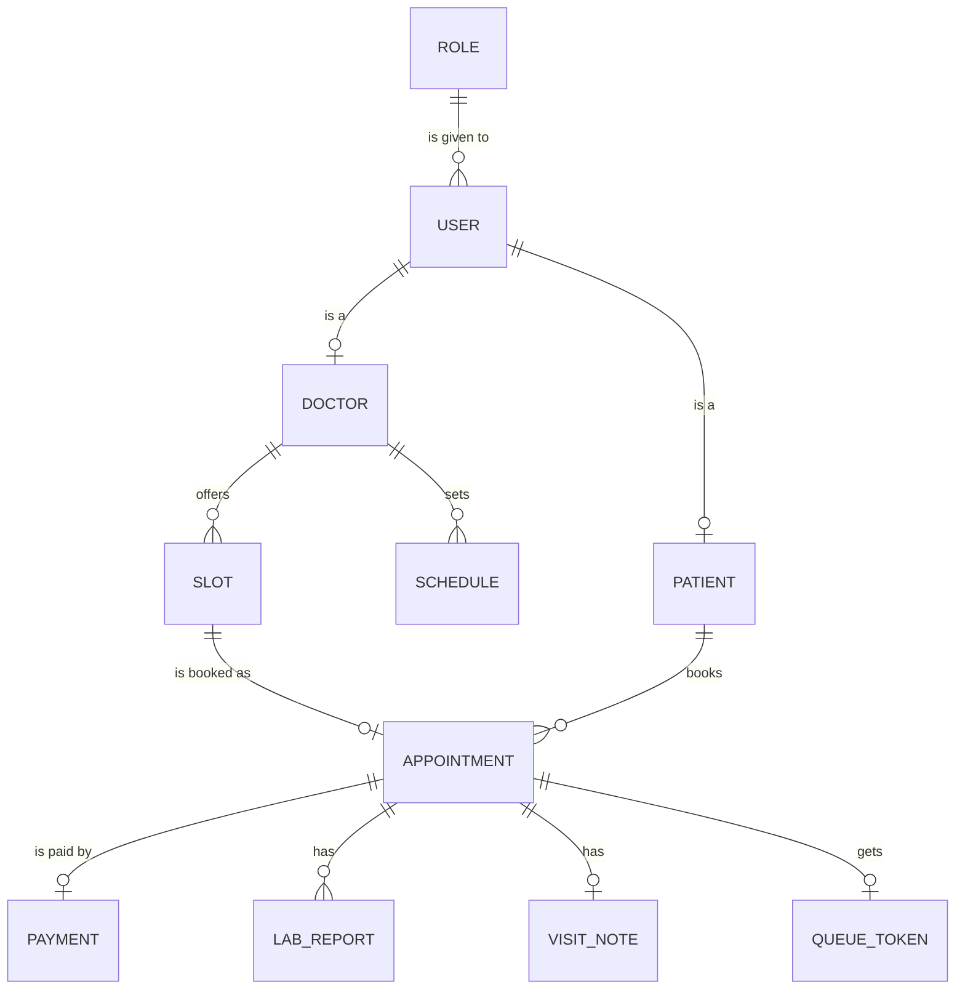

# ClinicDesk: appointments and a live queue for a neighbourhood clinic

One of the four capstone briefs. Read the [capstone README](../README.md) first: it explains the plan, the required parts and the AI rules.

## The problem

A clinic in Pune has three doctors and one receptionist. Patients phone to book, and the receptionist writes the bookings in a paper register. On busy mornings the phone rings without stop, and two patients get the same time. The waiting room fills with people who do not know when their turn will come. The OPD (outpatient department) token number is shouted from the door. Patients pay the consultation fee of ₹300 to ₹800 in cash or by UPI at the counter. At the end of the day, nobody can tell what was collected.

ClinicDesk lets patients book a slot online, shows the queue live, and gives the clinic one record of bookings, visits and fees.

## The users

- **Patient:** books, pays and sees their own visits. Often on a phone, often in a hurry.
- **Receptionist:** manages the day's bookings, checks patients in and calls the next token.
- **Doctor:** sees the day's patients, writes visit notes, and opens a patient's reports.
- **Clinic admin:** sets the doctors' hours, the fees and the clinic's rules, and reads the daily report.

## Core features

You need 10 to 15 stories in your plan; these 12 features give you more than enough. For the two "or" parts, pick one option and leave the other for a Stretch goal.

| # | Feature | What the user can do | Required part |
|---|---|---|---|
| 1 | Accounts and roles | Sign up and sign in; patient, receptionist, doctor and admin each see only their own screens | Sign-in and roles |
| 2 | Doctor schedules | The admin sets each doctor's weekly OPD hours, and the clinic offers 15-minute slots | |
| 3 | Booking | A patient books a free slot; two patients can never book the same slot | |
| 4 | Cancel and reschedule | A patient cancels or moves a booking up to 2 hours before it | |
| 5 | Own records only | A patient sees only their own visits; a doctor sees only the day's patients | Sign-in and roles |
| 6 | Pay the fee online | A patient pays the consultation fee through MockPay, with a refund when the clinic cancels | Payments (option) |
| 7 | Lab reports | A patient or the receptionist uploads a report straight to storage, and the doctor opens it in the visit | Uploads (option) |
| 8 | Live queue board | "Now serving token 14" changes on the waiting-room screen and on the patient's phone, without a refresh | Live updates (option) |
| 9 | Ask ClinicDesk | A patient asks about timings, fees or what to bring, and gets an answer that cites the clinic's policy page | AI answer (option) |
| 10 | Visit notes | The doctor writes notes and a prescription; the patient reads their own | |
| 11 | Reminders | An email goes out the evening before each appointment, from a background job | |
| 12 | Daily report | The admin sees bookings, no-shows and fees collected for any day | |

## The platform parts

Every capstone has these three parts. For ClinicDesk they could look like this:

**Tests and a pipeline with infrastructure as code:**

- a test that fires 20 bookings for one slot at once and expects exactly one to succeed;
- a GitHub Actions pipeline that tests, builds and scans the images;
- OpenTofu that creates the reports bucket and the $5 budget on the cloud lab.

**Containers and Kubernetes:**

- the web app, the API, PostgreSQL and Redis in one Compose stack;
- a Helm chart that runs 2 API replicas on k3d, with probes and limits.

**Observability, a real deploy and a cost report:**

- a dashboard with bookings an hour, errors and the p95 time of booking, and an alert on booking errors;
- one deploy to AWS behind the $5 budget alarm, torn down the same day;
- a report of what it cost.

## Suggested data model (entities only)

Your ERD adds the keys and attributes. Keep money in paise and times with their time zone.

- `USER` and `ROLE`: sign-in and the four roles, as in RailSeat (P5).
- `DOCTOR` and `PATIENT`: the profile of each kind of user.
- `SCHEDULE`: a doctor's weekly hours. `SLOT`: one 15-minute slot made from them.
- `APPOINTMENT`: a booked slot, with its status (booked, checked in, done, cancelled or no-show).
- `PAYMENT`, `LAB_REPORT`, `QUEUE_TOKEN`: one of each for the options you choose.
- `VISIT_NOTE`: the doctor's notes and prescription.

## Stretch ideas

- Hindi and Marathi screens, with a language switch.
- Family accounts: a parent books for a child or an elderly parent.
- A doctor's leave that moves every booking that day and tells each patient.
- After two no-shows, the patient pays a deposit to book.
- A video-call link for an online consultation.

## What "done" looks like at the demo

In about 10 minutes, with two browsers open:

1. Sign in as a patient in one browser and as the receptionist in the other.
2. The patient books the 10:15 slot with Dr Rao. A second booking of the same slot is refused with a clear message.
3. The patient pays ₹400 through MockPay, or uploads a lab report, and the receptionist sees it.
4. The receptionist calls token 3, and the waiting-room screen changes within 2 seconds. With the AI option, a patient asks "What should I bring?" and gets an answer with a citation.
5. Show the last pipeline run, then `kubectl get pods` for the Helm release on k3d.
6. Run a short k6 test and show the dashboard, then the alert rule.
7. Show the cost report and the teardown evidence from the real deploy.

Two numbers to show: no double booking in the 20-booking race test, and the p95 time of booking at 50 virtual users.

## Data and privacy

Health records are personal data, and India's Digital Personal Data Protection Act, 2023 protects them. Use made-up patients only: no real names, phone numbers, Aadhaar numbers or medical records, and no real reports. Make test reports with a short script, and keep every secret out of Git.
