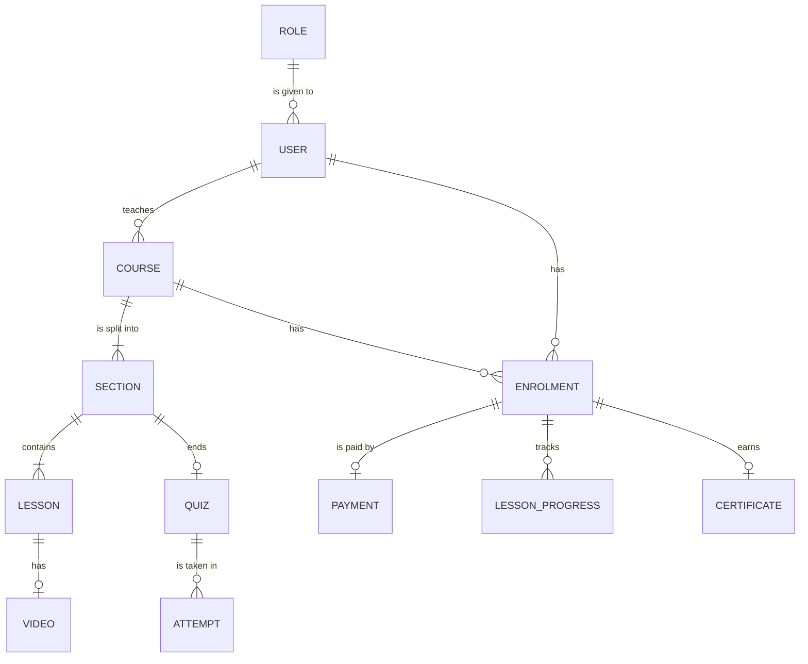

# Course platform: video courses for a coaching institute

One of the four capstone briefs. Read the [capstone README](../README.md) first: it explains the plan, the required parts and the AI rules.

## The problem

A coaching institute in Kota prepares students for engineering entrance exams. Its teachers record lessons in Hindi and English and share them as links in WhatsApp groups. Fees arrive by UPI, with a screenshot as the receipt. Nobody knows who has watched what, links get shared with people who never paid, and doubts asked in a group are lost in the chat. Many learners watch on a phone with limited mobile data.

The course platform puts courses, payments, progress and doubts in one place. Give your product its own name, for example PadhaiPath.

## The users

- **Learner:** enrols, pays, watches lessons, takes quizzes and asks doubts, mostly on a phone.
- **Teacher:** builds a course, uploads lessons, answers doubts and follows their learners' progress.
- **Admin:** approves courses, sets fees and refunds, and reads the institute's numbers.

## Core features

You need 10 to 15 stories in your plan; these 11 features give you more than enough. For the two "or" parts, pick one option and leave the other for a Stretch goal.

| # | Feature | What the user can do | Required part |
|---|---|---|---|
| 1 | Accounts and roles | Sign up and sign in as a learner; teachers and admins are given their roles | Sign-in and roles |
| 2 | Course catalogue | Browse courses, each split into sections and lessons, with the fee in rupees | |
| 3 | Lesson videos | A teacher uploads a video straight to storage; a worker makes a 480p copy and a thumbnail, as in ReelPipe (P8) | Uploads (option) |
| 4 | Enrol and pay | A learner pays the course fee through MockPay, with a refund within 7 days | Payments (option) |
| 5 | Only paid learners watch | A lesson plays only for learners enrolled in its course; a teacher edits only their own courses | Sign-in and roles |
| 6 | Progress | A learner marks lessons done and resumes where they stopped, on any device | |
| 7 | Quizzes | Multiple-choice quizzes, marked by the server, with a pass mark | |
| 8 | Live doubt room | During a live class, questions and answers appear for everyone without a refresh | Live updates (option) |
| 9 | Ask the notes | A learner asks about a course's notes and gets an answer that cites the lesson | AI answer (option) |
| 10 | Certificates | A learner who passes every quiz gets a certificate with a check link anyone can open | |
| 11 | Teacher dashboard | Enrolments, completion and quiz scores for each of the teacher's courses | |

## The platform parts

Every capstone has these three parts. For the course platform they could look like this:

**Tests and a pipeline with infrastructure as code:**

- a test that a learner who did not pay gets 403 for a lesson;
- a pipeline that tests, builds and scans the images;
- OpenTofu that creates the videos bucket, the job queue and the $5 budget on the cloud lab.

**Containers and Kubernetes:**

- the web app, the API, the video worker, PostgreSQL and Redis in Compose;
- a Helm chart on k3d with probes and limits, with the worker scaled apart from the API.

**Observability, a real deploy and a cost report:**

- a dashboard with lessons played, video jobs waiting and failed, and the p95 time of the catalogue;
- an alert when the video queue grows;
- one deploy to AWS behind the $5 budget alarm, torn down the same day;
- a cost report that includes video storage.

## Suggested data model (entities only)

Your ERD adds the keys and attributes. Keep money in paise.

- `USER` and `ROLE`: sign-in, with the learner, teacher and admin roles.
- `COURSE`, `SECTION` and `LESSON`: what is taught, in order. `VIDEO` for the uploads option, with its status (uploaded, processing, ready or failed).
- `ENROLMENT`: a learner on a course. `PAYMENT` for the payments option.
- `LESSON_PROGRESS`: which lessons a learner has finished, and where they stopped.
- `QUIZ` and `ATTEMPT`: questions, answers and scores. `CERTIFICATE`: earned once, with a check code.

## Stretch ideas

- Adaptive streaming, so a video plays well on a slow connection.
- Subtitles in Hindi and English.
- A discussion thread under each lesson.
- Downloads for watching offline, for enrolled learners only.
- Teacher payouts from a ledger.

## What "done" looks like at the demo

In about 10 minutes, with two browsers open:

1. A teacher uploads a 2-minute lesson video. The status moves from processing to ready, and a 480p copy appears.
2. A learner who has not paid tries to open the lesson and is refused.
3. The learner enrols and pays ₹1,999 through MockPay, watches half the lesson, and resumes from the same point on a second device.
4. The learner takes the section quiz and passes. With the live option, a doubt asked in the doubt room appears in the teacher's browser within 2 seconds. With the AI option, a question about the notes gets an answer with a citation.
5. Open the certificate's check link in a browser that is not signed in.
6. Show the pipeline run, the Helm release on k3d, and the dashboard while two videos are processed.
7. Show the cost report and the teardown evidence.

Two numbers to show: the time from upload to "ready" for a 2-minute video, and the p95 time of the catalogue at 50 virtual users.

## Data and privacy

Use made-up learners and teachers. Record your own short test videos, or use clips whose licence allows it, and never upload a coaching institute's real material. Keep every secret out of Git.
