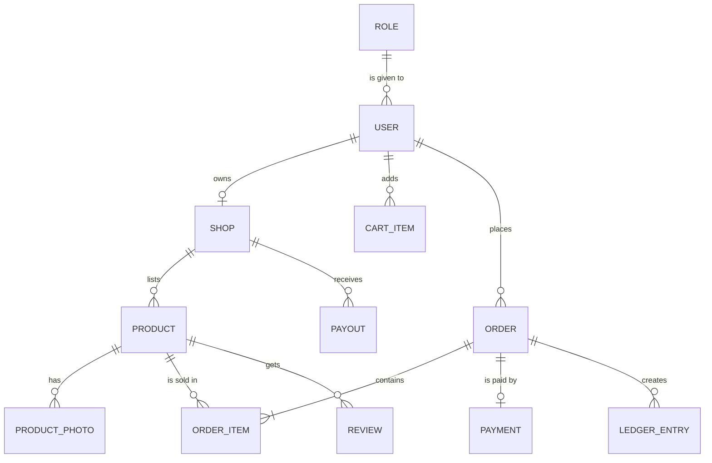

# Marketplace: an online haat for local makers

One of the four capstone briefs. Read the [capstone README](../README.md) first: it explains the plan, the required parts and the AI rules.

## The problem

In Pune, home bakers, potters and handloom weavers sell through WhatsApp groups and Instagram messages. A buyer asks "Is this still available?", waits hours for an answer, and pays by UPI to a stranger with no record of the order. Makers keep stock in their heads, sell the last piece twice, and lose track of who has paid. A haat (a traditional Indian market) brings sellers and buyers to one place; this product does the same online, for one city.

Give your product its own name, for example HaatHub.

## The users

- **Buyer:** searches, buys, pays and follows an order, mostly on a phone.
- **Seller:** runs a shop, lists products with photos, packs orders and gets paid.
- **Admin:** keeps the market safe: hides a bad listing, suspends a seller, and reads the platform's takings.

## Core features

You need 10 to 15 stories in your plan; these 12 features give you more than enough. For the two "or" parts, pick one option and leave the other for a Stretch goal.

| # | Feature | What the user can do | Required part |
|---|---|---|---|
| 1 | Accounts and roles | Sign up and sign in as a buyer or a seller; the admin role is given, not chosen | Sign-in and roles |
| 2 | Shops and listings | A seller opens a shop and lists products with a price in rupees and the stock in hand | |
| 3 | Product photos | A seller uploads photos straight to storage; a worker makes a thumbnail | Uploads (option) |
| 4 | Search | A buyer searches by words, category, price and area, with full-text search as in P10 | |
| 5 | Cart and checkout | A buyer pays through MockPay, and a signed webhook confirms the payment | Payments (option) |
| 6 | Fair stock | When two buyers take the last item at once, exactly one order succeeds | |
| 7 | Order status | An order moves through placed, paid, packed, shipped, delivered or cancelled, as a state machine | |
| 8 | Seller payouts | A double-entry ledger records each sale, the 5% platform fee and each payout | Payments (option) |
| 9 | Live order updates | The buyer and the seller see an order's status change without a refresh | Live updates (option) |
| 10 | Ask the market | A buyer asks about shipping or returns and gets an answer that cites the market's policy page | AI answer (option) |
| 11 | Reviews | Only a buyer who received an item can review it, once | Sign-in and roles |
| 12 | Moderation | The admin hides a product or suspends a seller, and every action is logged | Sign-in and roles |

## The platform parts

Every capstone has these three parts. For the marketplace they could look like this:

**Tests and a pipeline with infrastructure as code:**

- a test that two buyers racing for the last item get one order between them;
- a pipeline that tests, builds and scans the images;
- OpenTofu that creates the photos bucket and the $5 budget on the cloud lab.

**Containers and Kubernetes:**

- the web app, the API, a worker, PostgreSQL and Redis in Compose;
- a Helm chart on k3d with 2 API replicas, probes and limits.

**Observability, a real deploy and a cost report:**

- a dashboard with orders an hour, failed payments and the p95 time of search, and an alert on failed webhooks;
- one deploy to AWS behind the $5 budget alarm, torn down the same day;
- a cost report.

## Suggested data model (entities only)

Your ERD adds the keys and attributes. Keep money in paise and stock as a whole number.

- `USER` and `ROLE`: sign-in, with the buyer, seller and admin roles.
- `SHOP` and `PRODUCT`: what a seller offers, with price and stock. `PRODUCT_PHOTO` for the uploads option.
- `CART_ITEM`, `ORDER` and `ORDER_ITEM`: what a buyer picks and pays for.
- `PAYMENT`, `LEDGER_ENTRY` and `PAYOUT`: money in, the platform's fee, and money out to sellers.
- `REVIEW`: one review per delivered order item.

## Stretch ideas

- UPI QR checkout in Razorpay test mode.
- Discount coupons with a usage limit.
- A delivery partner role that marks orders picked up and delivered.
- A sales dashboard for each seller.
- Hindi and Marathi listings.

## What "done" looks like at the demo

In about 10 minutes, with two or three browsers open:

1. A seller lists a terracotta diya set at ₹450 with a photo and a stock of 1.
2. A buyer searches "terracotta" in Pune and finds it.
3. Two buyers try to buy the last set at once: exactly one order succeeds.
4. The winning buyer pays through MockPay. With the live option, the seller sees the order turn "paid" without a refresh. With the AI option, the buyer asks "Can I return a broken diya?" and gets an answer with a citation.
5. Show the ledger for the sale: ₹450 in, the ₹22.50 fee, and the seller's ₹427.50.
6. Show the pipeline run, the Helm release on k3d, and the dashboard during a short k6 test.
7. Show the cost report and the teardown evidence.

Two numbers to show: one order out of two in the race test, and the p95 time of search at 50 virtual users.

## Data and privacy

Use made-up sellers, buyers and products. Do not copy product photos or text from a real shop or marketplace website, and do not collect real addresses or phone numbers. Generate test data with a short script, and keep every secret out of Git.
