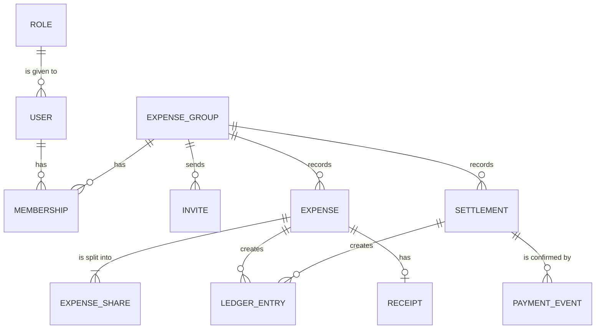

# Shared expenses: bills and balances for flatmates and trips

One of the four capstone briefs. Read the [capstone README](../README.md) first: it explains the plan, the required parts and the AI rules.

## The problem

Four flatmates in a PG (paying-guest house) in Bengaluru share rent, groceries, the Wi-Fi bill and the cook's salary. Five college friends on a trip to Goa share hotels, taxis and dinners. Each group tracks spending in a WhatsApp chat or a notebook. At the end of the month the numbers never agree, and a rupee or two goes missing in every split. The person who paid most chases the others for weeks.

This product records every shared expense, splits it exactly to the paisa, shows who owes whom, and helps the group settle up. Give it its own name, for example Hisaab ("accounts" in Hindi).

## The users

- **Member:** adds expenses, sees what they owe or are owed, and pays it back.
- **Group owner:** creates the group, invites members, and keeps the member list tidy.
- **Site admin:** keeps the service safe, for example by disabling an abusive account.

## Core features

You need 10 to 15 stories in your plan; these 12 features give you more than enough. For the two "or" parts, pick one option and leave the other for a Stretch goal.

| # | Feature | What the user can do | Required part |
|---|---|---|---|
| 1 | Accounts and roles | Sign up and sign in; group owners and members have different rights, and only members see a group | Sign-in and roles |
| 2 | Groups and invites | An owner creates a group and invites flatmates with a one-time email link | |
| 3 | Add an expense | Split it equally, by exact amounts or by shares such as 2:1:1, exact to the paisa | |
| 4 | Balances | See who owes whom, from a double-entry ledger whose entries always add up to zero | |
| 5 | Settle up | Pay a friend through MockPay; a signed webhook clears the debt exactly once | Payments (option) |
| 6 | Bill photos | Attach a photo of the bill, uploaded straight to storage | Uploads (option) |
| 7 | Live updates | A flatmate's new expense appears on everyone's screen without a refresh | Live updates (option) |
| 8 | Ask the help pages | Ask "How do share splits work?" and get an answer that cites the app's help pages | AI answer (option) |
| 9 | The settle plan | See the fewest payments that clear the whole group | |
| 10 | Monthly summary | Spending by category for a month, and a CSV download | |
| 11 | Reminders | A weekly email to each member who owes money | |
| 12 | Undo | Bring back a deleted expense within 24 hours | |

Feature 9 needs a greedy algorithm the course does not teach. If your plan includes it, your tasks add a short learn card first.

## The platform parts

Every capstone has these three parts. For shared expenses they could look like this:

**Tests and a pipeline with infrastructure as code:**

- tests that every split adds up to the total in paise, and that a repeated webhook changes nothing;
- a pipeline that tests, builds and scans the images;
- OpenTofu that creates the bills bucket and the $5 budget on the cloud lab.

**Containers and Kubernetes:**

- the web app, the API, PostgreSQL and Redis in Compose;
- a Helm chart on k3d with 2 API replicas, and live updates that still reach everyone when one pod restarts.

**Observability, a real deploy and a cost report:**

- a dashboard with expenses added, settle-ups by status and the p95 time of the balances page, and an alert on failed settle-ups;
- one deploy to AWS behind the $5 budget alarm, torn down the same day;
- a cost report.

## Suggested data model (entities only)

Your ERD adds the keys and attributes. Keep money in paise, and let the ledger hold the balances.

- `USER` and `ROLE`: sign-in, as in RailSeat (P5).
- `EXPENSE_GROUP` and `MEMBERSHIP`: who is in which group, as owner or member. `INVITE`: a one-time link.
- `EXPENSE` and `EXPENSE_SHARE`: what was paid, by whom, and each member's share.
- `SETTLEMENT` and `PAYMENT_EVENT` for the payments option; `RECEIPT` for the uploads option.
- `LEDGER_ENTRY`: every movement of money, so that the balances always add up to zero.

## Stretch ideas

- Expenses in two or more currencies for a trip abroad, converted at a stored rate.
- Repeating expenses, such as rent on the 1st of every month.
- UPI payment links in Razorpay test mode.
- Spending insights: the biggest categories this month compared with last month.
- An activity log of who changed what, for the group owner.

## What "done" looks like at the demo

In about 10 minutes, with two or three browsers open:

1. Three flatmates in one group. One adds a ₹1,200 dinner split equally; the shares are ₹400 each.
2. Another adds ₹1,000 of groceries by shares 2:1:1; the shares are ₹500, ₹250 and ₹250, and the balances add up to zero.
3. One member settles up through MockPay. Send the same webhook twice: the debt clears once. With the uploads option, attach a bill photo instead.
4. With the live option, the new expense appears in the other browsers within 2 seconds. With the AI option, ask "How do share splits work?" and get an answer with a citation.
5. Show the settle plan, if you built it.
6. Show the pipeline run, the Helm release on k3d, and the dashboard during a short k6 test.
7. Show the cost report and the teardown evidence.

Two numbers to show: every split test adds up exactly, and the p95 time of the balances page at 50 virtual users.

## Data and privacy

Use made-up people, groups and amounts. Never store real bank or UPI details, real phone numbers or real bill photos with personal information on them. Keep every secret out of Git.
