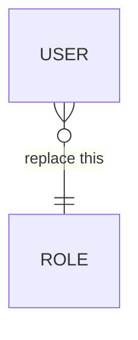
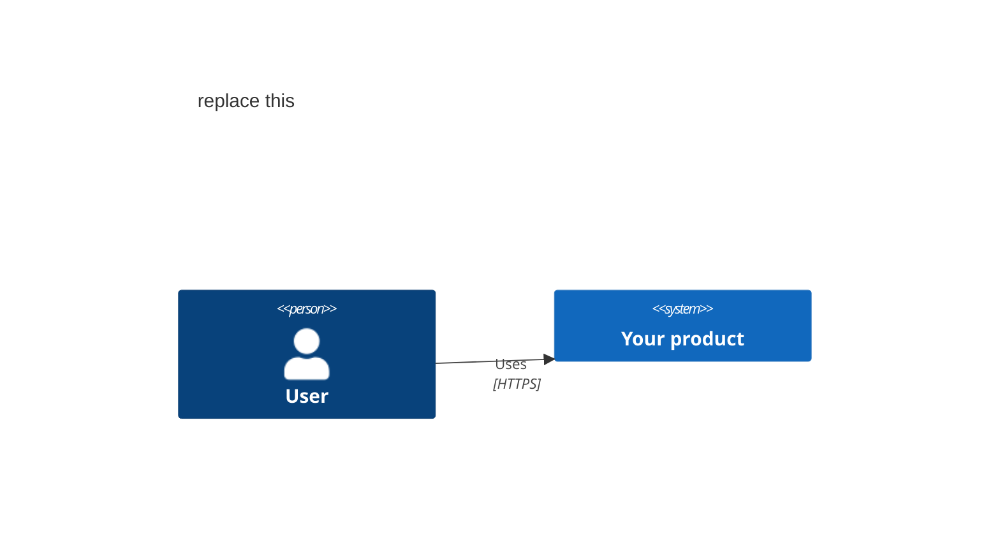
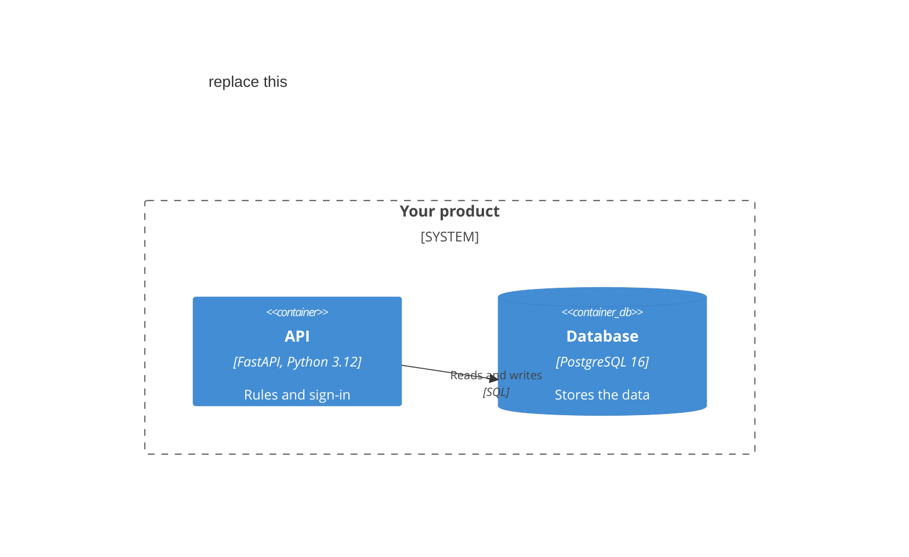

# Capstone plan

> **How to use this file.** Copy it to `capstone/PLAN.md` in your task folder. Your CP1 tasks fill it one part at a time, and task 13 checks that no part is empty or still template text.
> Keep every `##` heading, and the two `###` headings under Architecture, exactly as they are. AxPlanner (the tool that turns your approved plan into tasks) finds each part by its heading.
> Lines that start with `>` are guidance. Delete them when you finish a part.
> Never put real personal data in the plan: no real names, phone numbers, Aadhaar or PAN numbers, or medical records.

## Product

> Task 6. Write the product's name, the brief you chose or "Own pitch", and the problem it solves in 3 or 4 sentences. Then name 2 to 4 kinds of user and what each one needs. Add your two reasons, and at least three things the product will not do.

**Name:**

**Brief:**

**Problem:**

**Users:**

-

**Why I chose it:**

1.
2.

**Not in this capstone:**

-

## Users and stories

> Task 7. List your kinds of user, one line each. Then write 10 to 15 stories, numbered S01, S02 and so on, each as "As a <user>, I want <goal>, so that <reason>".
> Under each story, write 2 to 4 acceptance criteria as Given, When, Then, with real values such as ₹500 or 09:30. At least one criterion of each story is an unhappy path: an error, an empty list or a forbidden action.
> Task 13 adds a priority (Must, Should or Could) and an estimate in hours to each story. A finished story looks like this:
>
> **S01.** As a patient, I want to book a free slot with a doctor, so that I do not queue at the clinic. Priority: Must. Estimate: 3 h.
> - Given Dr Rao has a free slot at 09:30, when I book it, then I see "Booked for 09:30".
> - Given the 09:30 slot is taken, when I try to book it, then I see "This slot is no longer free".

Kinds of user:

-

**S01.** As a
- Given
- Given

## Data model

> Task 8. Draw one Mermaid `erDiagram`: `USER` and `ROLE` as in RailSeat (P5), then one entity for each thing your stories store. Give every entity an `id` marked `PK`, typed attributes, and `FK` and `UK` marks. Keep money as integer paise (`int fee_paise`) and times as `timestamptz`. Label every relationship.
> Below the diagram, list at least two rules the database enforces, each with its constraint. Then fill the table: every story and the entities it reads or writes. Replace the example line in the diagram.

Rules the database enforces:

-

| Story | Entities it reads or writes |
|---|---|
| S01 |  |

## API contract

> Task 9. Write the full contract in `openapi.yaml`, next to this file. Start from the kit's skeleton, `capstone/plan-template/openapi.yaml`. Then list every path here, with the roles allowed and the story IDs.

Full contract: [openapi.yaml](openapi.yaml)

| Method | Path | Roles allowed | Stories |
|---|---|---|---|
|  |  |  |  |

## Architecture

> Task 10. Two Mermaid diagrams. Label every arrow with what flows and the protocol, such as HTTPS and JSON, SQL or WebSocket. If a C4 block does not draw on GitHub, redraw it as a `flowchart` with the same boxes and labels.

### Context

> Every kind of user (`Person`), your product as one `System`, and each outside system (`System_Ext`), such as MockPay or the email server. Then 3 to 5 sentences that explain the diagram. Replace the example lines.

### Containers

> Every running part inside one `System_Boundary`: the web app, the API, PostgreSQL and every other part, each with its technology and job. Then 3 to 5 sentences, and a list naming the container behind each of the six required parts. Replace the example lines.

## Decisions

> Task 11. Three decision records in `docs/adr/`, next to this file, named `0001-<short-name>.md` to `0003-<short-name>.md`. List them here, one line each, with a link to each file.

- [1. <the decision>](docs/adr/0001-<short-name>.md)
- [2. <the decision>](docs/adr/0002-<short-name>.md)
- [3. <the decision>](docs/adr/0003-<short-name>.md)

## Cost

> Task 12. State your assumptions first: users, requests a day, data stored and data sent out a month. Price the design on AWS in Mumbai (`ap-south-1`) and on one other cloud: Azure (Central India), Google Cloud (Mumbai) or DigitalOcean (Bangalore).
> Give each total in US dollars and in rupees, with the exchange rate and the date you checked the prices. Then name two cost traps and how your design avoids each, and say which cloud is cheaper and what would change that.

**Assumptions:**

**AWS (Mumbai, `ap-south-1`):**

| Service | Size | Unit price | $ a month |
|---|---|---|---|
|  |  |  |  |
| **Total** |  |  |  |

**Second cloud:**

| Service | Size | Unit price | $ a month |
|---|---|---|---|
|  |  |  |  |
| **Total** |  |  |  |

**Totals in rupees, exchange rate and date:**

**Cost traps:**

-

**Cheaper cloud:**

## Required parts

> Task 6 names a feature for each part, and task 13 completes the table. Keep all six rows. For the two "or" rows, write the option you chose under "My choice".

| Required part | My choice | Feature | Reused from | Stories | Milestone |
|---|---|---|---|---|---|
| Sign-in and roles | — |  | RailSeat (P5) |  |  |
| Payments or uploads |  |  |  |  |  |
| Live updates or a small AI answer feature |  |  |  |  |  |
| Tests and a pipeline with infrastructure as code | — |  | Shortly (P11) |  |  |
| Containers and Kubernetes | — |  | Shortly (P7), TiffinTrack (P12) |  |  |
| Observability, a real deploy and a cost report | — |  | TiffinTrack (P12), Shortly (P13) |  |  |

## Milestones

> Task 13. Three milestones, each with its stories and parts, its total hours and one demo sentence. Keep each near its budget. The budgets leave room for each module's course tasks and wrap-up. Do not plan more than about 20 hours a week.
> If a milestone is over its hours, move Could stories out first, then Should stories, and list what you moved.

**M1 Core (weeks 24 and 25), about 34 hours**

> Sign-in and roles, the Must stories, your payments-or-uploads part, and tests for the core flows.

- Stories and parts:
- Total hours:
- At the demo I will show

**M2 Extend (weeks 26 and 27), about 28 hours**

> The features you will build with a coding agent, your live-updates-or-AI part, Kubernetes, the pipeline with infrastructure as code, and observability.

- Stories and parts:
- Total hours:
- At the demo I will show

**M3 Ship (week 28), about 10 hours**

> The load test, the budget alarm and the real deploy, and the cost report.

- Stories and parts:
- Total hours:
- At the demo I will show

**Moved out to stay within the hours:**

-
