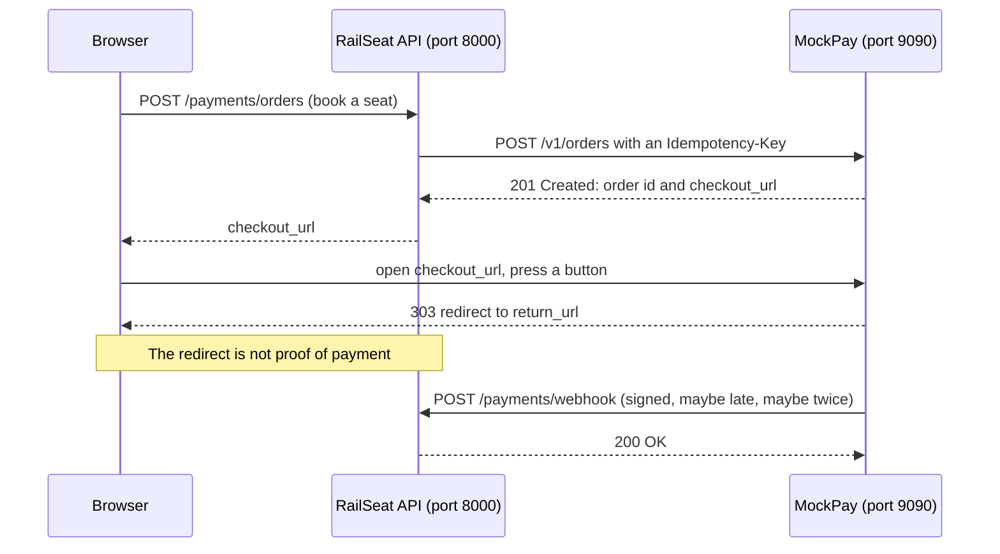

# MockPay

MockPay is a **pretend payment gateway** for the course. It works like a real Indian gateway such as Razorpay, but it runs on your own computer and you do not need to sign up anywhere. In project P6 your RailSeat API uses it to take payments for bookings.

MockPay gives you:

- **orders**: your app says how much the customer must pay;
- **a hosted checkout page** with three test buttons: a payment that succeeds, one the bank declines, and one that times out;
- **signed webhooks**: MockPay tells your app what happened, with an HMAC-SHA256 signature. It sends some webhooks **late** and some **twice** on purpose, and it retries when your app does not answer;
- **refunds**, in full or in parts;
- **a daily settlement report** with fees and the net payout, for your reconciliation job;
- **a dashboard** that shows everything MockPay did, including every webhook attempt.

> **MockPay is not a real payment gateway. Never send real card or UPI details to it, and never type them on its pages.** It moves no money. Its keys and secrets are test values for learning only.

## Contents

1. [Run MockPay](#1-run-mockpay)
2. [How a payment flows](#2-how-a-payment-flows)
3. [API reference](#3-api-reference)
4. [Webhooks](#4-webhooks)
5. [Verify a webhook signature in Python](#5-verify-a-webhook-signature-in-python)
6. [Why some webhooks come late or twice](#6-why-some-webhooks-come-late-or-twice)
7. [The settlement report](#7-the-settlement-report)
8. [Statuses](#8-statuses)
9. [MockPay's own tests](#9-mockpays-own-tests)

---

## 1. Run MockPay

MockPay listens on port **9090**. Run it with Docker or with uv; you need only one of them.

The commands in this README are for Git Bash, the VS Code terminal from the kit's Windows setup guide (`setup/windows.md`). They also work in a macOS or Linux terminal. In Windows PowerShell, `curl` is a different program, so use Git Bash.

### With Docker (recommended)

```bash
cd ~/fspy-v3-kit/mockpay
docker compose up --build
```

The first start downloads Python and the packages, so it takes a minute. Stop MockPay with `Ctrl+C`. To run it in the background, use `docker compose up --build -d`, and read its log with `docker compose logs -f`.

### With uv

```bash
cd ~/fspy-v3-kit/mockpay
uv sync
MOCKPAY_WEBHOOK_URL=http://localhost:8000/payments/webhook uv run mockpay
```

Outside Docker, your RailSeat API is at `localhost`, so you must set `MOCKPAY_WEBHOOK_URL` as shown. The data is kept in the file `mockpay.db` in the folder where you start MockPay.

### Check that it runs

```bash
curl http://localhost:9090/health
```

You should see `{"status":"ok"}`. Then open these pages in your browser:

- <http://localhost:9090/dashboard>: everything MockPay did;
- <http://localhost:9090/docs>: the API, where you can try each endpoint (press **Authorize** and enter `mp_test_key`).

### Where MockPay sends webhooks

MockPay sends webhooks to `MOCKPAY_WEBHOOK_URL`. Your RailSeat API receives them at `POST /payments/webhook` on port 8000.

| MockPay runs | RailSeat API runs | Use this `MOCKPAY_WEBHOOK_URL` |
|---|---|---|
| in Docker | on your computer (`uv run fastapi dev`) | `http://host.docker.internal:8000/payments/webhook` (the default) |
| with uv | on your computer | `http://localhost:8000/payments/webhook` |
| in the same Compose project as the API | as the Compose service `api` | `http://api:8000/payments/webhook` |

`host.docker.internal` is the name of your own computer, seen from inside a container.

- **Docker Desktop** (the course setup on Windows, and macOS) knows this name already, and it reaches RailSeat even though `fastapi dev` listens only on `127.0.0.1`. Nothing else is needed.
- **Docker Engine on Linux** (not the course setup) learns the name from the `extra_hosts` line in `compose.yaml`. There is one more step: `fastapi dev` listens only on `127.0.0.1`, which a container cannot reach there. Start RailSeat like this instead:

  ```bash
  uv run fastapi dev app/main.py --host 0.0.0.0
  ```

If the dashboard shows "could not connect" for your webhooks, check three things: RailSeat is running, the port is 8000, and (only with Docker Engine on Linux) RailSeat was started with `--host 0.0.0.0`.

### Settings

MockPay reads its settings from environment variables. Every setting has a default.

| Variable | Default | What it does |
|---|---|---|
| `MOCKPAY_WEBHOOK_URL` | `http://host.docker.internal:8000/payments/webhook` | Where webhooks are sent. |
| `MOCKPAY_WEBHOOK_SECRET` | `mockpay_test_secret` | The shared secret for webhook signatures. RailSeat needs the same value. |
| `MOCKPAY_API_KEY` | `mp_test_key` | The key your API sends as `Authorization: Bearer mp_test_key`. |
| `MOCKPAY_DUPLICATE_RATE` | `0.3` | The share of webhooks sent twice: `0` never, `1` always. |
| `MOCKPAY_DELAY_SECONDS` | `2` | Seconds before the first try of each webhook. One webhook in five also waits a random 0 to 10 seconds more. |
| `MOCKPAY_TIMEOUT_SECONDS` | `30` | Seconds before a "Pay (times out)" payment fails. |

With Docker Compose you can put these in a `.env` file next to `compose.yaml` (copy `.env.example`), or give them on the command line:

```bash
MOCKPAY_DUPLICATE_RATE=1 docker compose up      # every webhook is sent twice
```

You will rarely need these finer settings:

| Variable | Default | What it does |
|---|---|---|
| `MOCKPAY_LATE_RATE` | `0.2` | The share of webhooks that wait longer than the normal delay. |
| `MOCKPAY_LATE_MAX_SECONDS` | `10` | The most extra delay for a late webhook. |
| `MOCKPAY_DUPLICATE_GAP_SECONDS` | `3` | The copy of a webhook comes 0 to this many seconds after the first. |
| `MOCKPAY_RETRY_DELAYS` | `1,5,25` | Seconds to wait before each retry. |
| `MOCKPAY_ANSWER_TIMEOUT_SECONDS` | `10` | How long MockPay waits for your webhook endpoint to answer. |
| `MOCKPAY_PUBLIC_URL` | `http://localhost:9090` | The start of every `checkout_url`. |
| `MOCKPAY_DB_PATH` | `mockpay.db` (Docker: `/data/mockpay.db`) | The SQLite file. |
| `MOCKPAY_HOST`, `MOCKPAY_PORT` | `127.0.0.1`, `9090` (Docker: `0.0.0.0`) | Where MockPay listens. |
| `MOCKPAY_POLL_SECONDS` | `0.2` | How often the webhook sender looks for work. |

`compose.yaml` passes on only the six main settings. To change a finer one in Docker, add a line for it under `environment:` in `compose.yaml`.

### Start again with no data

- Docker: `docker compose down -v` (the `-v` deletes the data volume), then `docker compose up`.
- uv: stop MockPay and delete `mockpay.db`.

---

## 2. How a payment flows



1. Your API creates an **order** at MockPay for the amount to pay.
2. Your web app sends the customer to the order's **checkout_url**.
3. The customer presses a button. MockPay creates a **payment** and sends the customer back to your **return_url**.
4. MockPay sends a **webhook** to your API to say what happened. Only this webhook (or `GET /v1/payments/{id}`) tells you the truth. The redirect only tells you that the customer is back.

---

## 3. API reference

All money is in **paise, as whole numbers**: ₹1,250.00 is `125000`. MockPay refuses `1250.5`, `1250.0` and `"1250"`. All times are ISO 8601 in Indian Standard Time, for example `2026-11-10T15:45:30+05:30`.

### Authentication

Every endpoint under `/v1` needs your API key:

```
Authorization: Bearer mp_test_key
```

Without it, or with a wrong key, MockPay answers `401`. The checkout page and the dashboard need no key.

### Errors

Every error has the same shape. `code` is for your program; `message` is for people.

```json
{"error": {"code": "refund_exceeds_captured", "message": "You asked to refund 80000 paise, but only 75000 paise of this payment can still be refunded (captured 125000, already refunded 50000)."}}
```

| Status | When |
|---|---|
| `400` | The body or a query value is wrong (`invalid_request`), or a refund is not allowed. |
| `401` | The API key is missing or wrong (`invalid_api_key`). |
| `404` | The order, payment or event does not exist. |
| `409` | An `Idempotency-Key` was used before with a different body (`idempotency_key_reused`). |

### Idempotency keys

`POST /v1/orders` and `POST /v1/refunds` accept an `Idempotency-Key` header. Use a new unique value for each new request, for example a UUID or `booking-<PNR>`.

- **The same key and the same body** return the first answer again. MockPay does not create a second order or a second refund. The answer has the header `Idempotent-Replayed: true`.
- **The same key with a different body** gets `409`.
- If a request fails (any `4xx`), MockPay does not keep the key, so you can fix the request and send it again with the same key.

This is how your API can safely retry a request after a network error.

### `POST /v1/orders`: create an order

| Field | Type | Required | Notes |
|---|---|---|---|
| `amount_paise` | integer | yes | From `100` (₹1) to `1000000000` (₹1 crore). |
| `currency` | string | yes | Must be `"INR"`. |
| `receipt` | string | yes | Your own reference, 1 to 40 characters, for example the PNR. |
| `notes` | object | no | Up to 15 key–value pairs. MockPay keeps them and gives them back. |
| `return_url` | string | no | Where checkout sends the customer afterwards. Must start with `http://` or `https://`. |

```bash
curl -s -X POST http://localhost:9090/v1/orders \
  -H "Authorization: Bearer mp_test_key" \
  -H "Content-Type: application/json" \
  -H "Idempotency-Key: booking-PNR4F7K2Q9" \
  -d '{"amount_paise": 125000, "currency": "INR", "receipt": "PNR4F7K2Q9",
       "notes": {"train": "12951"}, "return_url": "http://localhost:5173/payments/return"}'
```

Answer, `201 Created`:

```json
{
  "id": "order_Kq3vX9mT2bLw8P",
  "amount_paise": 125000,
  "currency": "INR",
  "receipt": "PNR4F7K2Q9",
  "notes": {"train": "12951"},
  "status": "created",
  "amount_paid_paise": 0,
  "attempts": 0,
  "payments": [],
  "return_url": "http://localhost:5173/payments/return",
  "checkout_url": "http://localhost:9090/checkout/order_Kq3vX9mT2bLw8P",
  "created_at": "2026-11-10T15:45:30+05:30"
}
```

### `GET /v1/orders/{order_id}`: read an order

```bash
curl -s http://localhost:9090/v1/orders/order_Kq3vX9mT2bLw8P -H "Authorization: Bearer mp_test_key"
```

It returns the same fields as above, with the order's current `status`, `attempts` (how many payments were tried) and `payments` (their ids).

### `GET /checkout/{order_id}`: the hosted checkout page

Send the customer's browser to the order's `checkout_url`. The page shows the amount and three test buttons:

| Button | What happens | Webhook |
|---|---|---|
| **Pay with UPI (succeeds)** | The payment is `captured`. The order is `paid`. | `payment.captured`, after the normal delay |
| **Pay (bank declines)** | The payment is `failed` with reason `bank_declined`. | `payment.failed`, after the normal delay |
| **Pay (times out)** | The payment is `pending`: the bank never answers. After 30 seconds it becomes `failed` with reason `timeout`. | nothing for 30 seconds, then `payment.failed` |

After a button, MockPay sends the browser to the order's `return_url` with two query values added:

```
http://localhost:5173/payments/return?order_id=order_Kq3vX9mT2bLw8P&payment_id=pay_8fJ2kLmQ0rTz1x
```

If the order has no `return_url`, MockPay shows its own result page.

The customer may try again after a decline or a time-out, so one order can have several payments. Once an order is `paid`, the page says so and has no buttons.

You can press the buttons without a browser, which is handy in automated tests. The value is `succeed`, `decline` or `timeout`:

```bash
curl -s -i -X POST -d outcome=succeed http://localhost:9090/checkout/order_Kq3vX9mT2bLw8P/pay
```

There are no card or UPI fields on this page, on purpose. Never type real payment details anywhere on MockPay.

### `GET /v1/payments/{payment_id}`: read a payment

```bash
curl -s http://localhost:9090/v1/payments/pay_8fJ2kLmQ0rTz1x -H "Authorization: Bearer mp_test_key"
```

```json
{
  "id": "pay_8fJ2kLmQ0rTz1x",
  "order_id": "order_Kq3vX9mT2bLw8P",
  "amount_paise": 125000,
  "currency": "INR",
  "status": "captured",
  "reason": null,
  "amount_refunded_paise": 50000,
  "refunds": ["rfnd_Hn2pQ7vXc4LmZa"],
  "created_at": "2026-11-10T15:46:02+05:30",
  "captured_at": "2026-11-10T15:46:02+05:30",
  "failed_at": null
}
```

Use this when you must know the truth without waiting, for example when a webhook seems lost.

### `POST /v1/refunds`: refund a payment

| Field | Type | Notes |
|---|---|---|
| `payment_id` | string | A `captured` payment. |
| `amount_paise` | integer | At least `1`. Partial refunds are allowed. |

All refunds of one payment together may **never be more than the captured amount**. A refund that would go over it gets `400` with code `refund_exceeds_captured`. A payment that is not captured gets `400` with code `payment_not_captured`. MockPay processes every refund at once and sends a `refund.processed` webhook. Use an `Idempotency-Key` so that a retry cannot refund twice.

```bash
curl -s -X POST http://localhost:9090/v1/refunds \
  -H "Authorization: Bearer mp_test_key" \
  -H "Content-Type: application/json" \
  -H "Idempotency-Key: refund-PNR4F7K2Q9-1" \
  -d '{"payment_id": "pay_8fJ2kLmQ0rTz1x", "amount_paise": 50000}'
```

Answer, `201 Created`:

```json
{
  "id": "rfnd_Hn2pQ7vXc4LmZa",
  "payment_id": "pay_8fJ2kLmQ0rTz1x",
  "order_id": "order_Kq3vX9mT2bLw8P",
  "amount_paise": 50000,
  "currency": "INR",
  "status": "processed",
  "created_at": "2026-11-10T16:02:11+05:30"
}
```

### `GET /v1/settlements?date=YYYY-MM-DD`: the settlement report

```bash
curl -s "http://localhost:9090/v1/settlements?date=2026-11-10" -H "Authorization: Bearer mp_test_key"
```

See [section 7](#7-the-settlement-report) for every field.

### `POST /v1/simulate/webhook`: send a past event again

Use it to test duplicates whenever you like. `copies` (1 to 5, default 1) sends that many copies **at the same moment**, which is the hardest case for your code.

```bash
curl -s -X POST http://localhost:9090/v1/simulate/webhook \
  -H "Authorization: Bearer mp_test_key" \
  -H "Content-Type: application/json" \
  -d '{"event_id": "evt_N4c8sWq1ZpR7yT", "copies": 3}'
```

Answer, `202 Accepted`: `{"event_id": "evt_N4c8sWq1ZpR7yT", "deliveries": [41, 42, 43], "status": "scheduled"}`. Each copy is the same event id with the same bytes and signature. The **Send again** button on the dashboard does the same for one copy.

### `GET /v1/events` and `GET /v1/events/{event_id}`: past events

These help you find an event id, and show how each copy of an event was delivered.

```bash
# the latest payment.captured event of one order
curl -s "http://localhost:9090/v1/events?order_id=order_Kq3vX9mT2bLw8P&type=payment.captured&limit=1" \
  -H "Authorization: Bearer mp_test_key"
```

Query values: `limit` (1 to 100, default 20), `type`, `order_id`. The answer is `{"count": 1, "items": [...]}`. Each item is the event exactly as sent, plus `deliveries`: each copy's `kind` (`first`, `duplicate` or `resend`), its `status`, and every attempt with its `status_code` or `error`.

### `GET /dashboard`

An HTML page for you, not for customers. It shows the latest orders, payments, refunds and events, the webhooks that are waiting to be sent, and **every webhook attempt with its HTTP status code** (or why there was no answer). It reloads every 5 seconds; `/dashboard?refresh=0` stops that.

### Other endpoints

- `GET /health` answers `{"status":"ok"}`. Docker uses it to check that MockPay is healthy.
- `GET /docs` is the interactive API page.

---

## 4. Webhooks

When something happens to a payment or a refund, MockPay sends a `POST` to `MOCKPAY_WEBHOOK_URL`:

```
POST /payments/webhook
Content-Type: application/json
X-MockPay-Event-Id: evt_N4c8sWq1ZpR7yT
X-MockPay-Signature: sha256=4f0c1e…(64 hex characters in all)

{"id":"evt_N4c8sWq1ZpR7yT","type":"payment.captured","created_at":"2026-11-10T15:46:04+05:30","data":{"order_id":"order_Kq3vX9mT2bLw8P","payment_id":"pay_8fJ2kLmQ0rTz1x","amount_paise":125000,"status":"captured"}}
```

| `type` | Sent when | `data` |
|---|---|---|
| `payment.captured` | "Pay with UPI (succeeds)" | `order_id`, `payment_id`, `amount_paise`, `status: "captured"` |
| `payment.failed` | "Pay (bank declines)" at once, or "Pay (times out)" after 30 seconds | the same, with `status: "failed"` and `reason`: `"bank_declined"` or `"timeout"` |
| `refund.processed` | after `POST /v1/refunds` | `order_id`, `payment_id`, `refund_id`, `amount_paise` (the refund's amount), `status: "processed"` |

The event `id` (also in the `X-MockPay-Event-Id` header) is unique for each event. A copy of an event has the **same** id.

How MockPay delivers webhooks:

- **Answer with any 2xx status** to say "received". Any other status, or no answer within 10 seconds, counts as a failure.
- **Retries:** after a failure MockPay tries again after 1 second, then 5 seconds, then 25 seconds: 4 tries in total. Then it gives up. The dashboard shows "gave up", and you can send the event again with `POST /v1/simulate/webhook`.
- **Every try sends the same bytes**, so the signature is the same each time.
- **Delays:** each webhook waits 2 seconds before its first try, and one in five waits 0 to 10 seconds more. So the customer is often back on your site **before** the webhook arrives.
- **Duplicates:** about 3 events in 10 are sent twice. The copy comes 0 to 3 seconds after the first, so sometimes both arrive at almost the same moment.
- **No fixed order:** a late `payment.captured` can arrive after the `refund.processed` for the same payment.
- **Every attempt is logged**, on the dashboard and in MockPay's log.
- **Answer quickly.** If your handler is slow, MockPay counts a failure and sends the event again.

---

## 5. Verify a webhook signature in Python

MockPay signs the **raw request body** with HMAC-SHA256 and your shared secret, and sends `sha256=` and the hex digest in `X-MockPay-Signature`. Your API computes the same value and compares:

```python
import hashlib
import hmac


def is_valid_signature(raw_body: bytes, header: str | None, secret: str) -> bool:
    """True when the X-MockPay-Signature header matches the raw request body."""
    if not header or not header.startswith("sha256="):
        return False
    expected = hmac.new(secret.encode(), raw_body, hashlib.sha256).hexdigest()
    return hmac.compare_digest(header.removeprefix("sha256="), expected)
```

In a FastAPI route, read the raw bytes **before** you parse the JSON:

```python
raw_body = await request.body()
if not is_valid_signature(raw_body, request.headers.get("X-MockPay-Signature"), secret):
    ...  # reject it with 400 and change nothing in your database
event = json.loads(raw_body)
```

Take `secret` from the `MOCKPAY_WEBHOOK_SECRET` environment variable, never from your code.

Common mistakes:

- Checking `json.dumps(await request.json())` instead of the raw body. The bytes are different (MockPay sends JSON without spaces), so a good webhook fails the check.
- Comparing with `==`. `hmac.compare_digest` takes the same time wherever the first difference is, so an attacker cannot learn the signature by timing your answers.
- Forgetting the `sha256=` at the start of the header.

**Check your code with this example.** With the secret `mockpay_test_secret`, this body (one line, no spaces):

```
{"id":"evt_test","type":"payment.captured","created_at":"2026-11-10T15:45:30+05:30","data":{"order_id":"order_test","payment_id":"pay_test","amount_paise":125000,"status":"captured"}}
```

must give this header value:

```
sha256=23700b83f23fd1091239618a650204c029bf32e6820d005a9595b0824a862844
```

---

## 6. Why some webhooks come late or twice

This is **the hard problem of P6**: *the same payment webhook arrives twice; the customer must be charged once and the books must still balance.*

Real gateways promise to deliver every webhook **at least once**, not **exactly once**. A gateway sends an event again when it did not see your answer in time, for example because of a slow network, a timeout or a restart. Real webhooks can also arrive late, or in a different order from the events. MockPay does all of this on purpose, so you meet these problems on your laptop and not with real customers' money.

Your webhook handler must:

1. **Check the signature first.** A webhook with a wrong signature changes nothing.
2. **Be safe to run twice with the same event.** The booking is confirmed once, the ledger gets one set of entries, and the money still balances.
3. **Answer 2xx to an event it has already handled.** Otherwise MockPay keeps retrying it.
4. **Never trust the order of events.** Look at the current state before you change it.
5. **Never trust the redirect to `return_url`.** It only says that the customer came back. While the webhook is late, show "payment pending".

Questions to answer in your design (MockPay does not answer them for you):

- What will you store so that you can tell "I have already handled this event"?
- Two copies arrive **at the same moment**, and both check "have I seen this?" before either has saved anything. What stops both from going on? Which part of your system can enforce "only once"?
- What should happen when `payment.failed` (reason `timeout`) arrives for an order that another payment has already paid?

Ways to test your answers:

- `MOCKPAY_DUPLICATE_RATE=1`: every webhook comes twice.
- `POST /v1/simulate/webhook` with `"copies": 3`: three copies at the same moment.
- Stop your API, pay an order, and start the API again within half a minute: the retries arrive.
- Press "Pay (times out)" and watch what your app shows for 30 seconds.
- `MOCKPAY_DELAY_SECONDS=10`: the customer is always back long before the webhook.

---

## 7. The settlement report

A gateway does not pay the merchant for each payment separately. Once a day it pays out the day's money in one transfer, the **settlement**, minus its fees. Your reconciliation job compares this report with your own ledger.

`GET /v1/settlements?date=2026-11-10` covers one day in Indian Standard Time. You may ask for today; the report then shows the day so far.

```json
{
  "date": "2026-11-10",
  "currency": "INR",
  "fee_percent": 2,
  "payments": [
    {"payment_id": "pay_8fJ2kLmQ0rTz1x", "order_id": "order_Kq3vX9mT2bLw8P", "amount_paise": 10000, "fee_paise": 200, "captured_at": "2026-11-10T15:46:02+05:30"},
    {"payment_id": "pay_Tz1x8fJ2kLmQ0r", "order_id": "order_2bLw8PKq3vX9mT", "amount_paise": 12345, "fee_paise": 247, "captured_at": "2026-11-10T16:10:45+05:30"},
    {"payment_id": "pay_LmQ0rTz1x8fJ2k", "order_id": "order_X9mT2bLw8PKq3v", "amount_paise": 125, "fee_paise": 3, "captured_at": "2026-11-10T17:01:09+05:30"}
  ],
  "refunds": [
    {"refund_id": "rfnd_Hn2pQ7vXc4LmZa", "payment_id": "pay_8fJ2kLmQ0rTz1x", "order_id": "order_Kq3vX9mT2bLw8P", "amount_paise": 5000, "created_at": "2026-11-10T18:20:00+05:30"}
  ],
  "captured_paise": 22470,
  "refunded_paise": 5000,
  "fees_paise": 450,
  "net_payout_paise": 17020
}
```

| Field | Meaning |
|---|---|
| `date` | The day of the report (IST). |
| `currency` | Always `INR`. |
| `fee_percent` | MockPay's fee: 2% of each captured payment. |
| `payments` | Every payment **captured** on this day, with its own fee. Failed and pending payments are not here. |
| `payments[].fee_paise` | 2% of that payment, rounded to the nearest paisa. Exactly half a paisa rounds **up**: 2% of 125 paise is 2.5, so the fee is 3. (Python's `round(2.5)` gives 2, so do not use `round()` for this.) |
| `refunds` | Every refund **processed** on this day. A refund can belong to a payment from an earlier day. |
| `captured_paise` | The sum of the payments' amounts. |
| `refunded_paise` | The sum of the refunds' amounts. |
| `fees_paise` | The sum of the payments' fees. MockPay does not give the fee back when a payment is refunded. |
| `net_payout_paise` | `captured_paise - refunded_paise - fees_paise`: what MockPay pays you for the day. It is **negative** on a day with more refunds than payments: then you owe MockPay. |

Check the example: 10000 + 12345 + 125 = 22470 captured; fees 200 + 247 + 3 = 450; 22470 − 5000 − 450 = 17020.

---

## 8. Statuses

| Thing | Statuses |
|---|---|
| Order | `created` (nothing tried yet) → `attempted` (a payment failed or is pending) → `paid` (a payment was captured) |
| Payment | `pending` (only "times out", for 30 seconds) → `captured` or `failed` (with `reason` `bank_declined` or `timeout`) |
| Refund | `processed` |
| Webhook delivery (dashboard) | `waiting` → `sending` → `delivered` or `gave_up` |

---

## 9. MockPay's own tests

You do not need these for P6, but they show how MockPay is tested, and they are a good model for your own webhook tests. A small local HTTP server plays the role of your API and receives the webhooks.

```bash
uv run pytest
uv run ruff check .
```

What MockPay does not do: it has one merchant (one API key), it captures payments at once (no "authorise now, capture later"), it processes refunds at once, and it only works in INR. None of these matter for P6.
